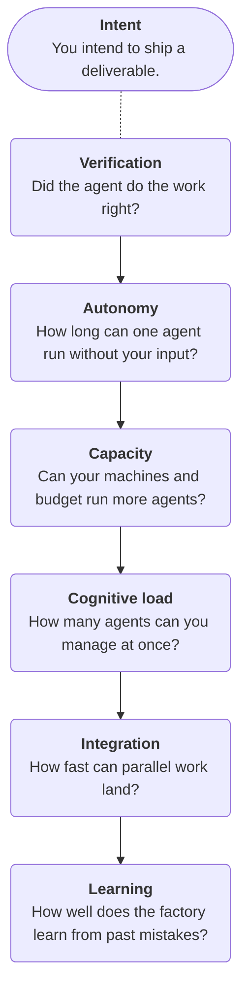

In 1984, Eliyahu Goldratt published [The Goal](https://www.amazon.com/Goal-Process-Ongoing-Improvement/dp/0884271951), a novel about turning around a failing physical factory to become wildly profitable. Fast forward 40 years and the book is as relevant as ever for software factories!

The key insight is that in any process, one constraint sets the pace for the entire process. This is known as the bottleneck, and it turns out that improving the performance of any step other than the bottleneck is a waste of time.

## Let's take a hike

The book illustrates the concept with a simple metaphor. Alex, the lead character responsible for turning the plant around, volunteers to lead his son's boy scout troop on a hike. He decides to line the boys up single file (one behind the other; no one walking next to each other), and off they go.

Before long, the boys are getting further and further away from each other. The fastest kids at the front keep pulling ahead, large gaps open up between them and scouts behind them, and the troop as a whole keeps falling behind schedule.

The problem is Herbie, the slowest hiker. The scouts in front of Herbie move at a fine pace. But the scouts behind Herbie have been instructed not to pass him, and so everyone is just waiting for him to move faster.

As a result, the entire troop can't reach their destination until Herbie does. Every minute the kids at the front gain from moving fast doesn't matter in the end. Once they reach their milestone, they just stop and wait for Herbie.

So Alex changes the plan. He moves Herbie to the front of the line, where no one can outpace him. That takes care of the gaps problem. Then he opens Herbie's pack, finds it full of heavy things, and splits them among the other boys. Now Herbie speeds up, and so does the whole troop.

## Only the bottleneck matters

Goldratt called this the Theory of Constraints. In any system, one constraint sets the pace for the whole. Speed up the constraint, and everything speeds up. Speed up anything else, and nothing changes, just like the kids at the front who reached a milestone early and then had to wait around for Herbie.

A follow-on insight is that once you relieve the bottleneck, a new one pops up!

## Software factories have bottlenecks, too

A software factory works the same way. At any moment, one part of the process limits how much useful work it can produce. 

If you produce and approve a prototype in 15 minutes, but then spend days on code review, you can see pretty quickly that making the prototype phase go even faster won't make much difference. But fixing that code review step will make a big difference!

## The hierarchy

In my experience, there is a common "hierarchy" of bottlenecks that individuals and teams go through on the way to building a software factory. 

### Verification

Lauren Tan (better known as the venerable `@poteto` on X) makes the case that [verification is the first bottleneck](https://x.com/poteto/status/2094457600259842065). 

We need _confidence_ about a work product before we can accept it. That confidence relates to:

- Simplicity
- Correctness
- Usability
- Observability
- Security
- Maintainability

And possibly more. We can establish confidence by having agents assess the work product along these dimensions, or we can do the review ourselves.

Some teams assess the risk level of their work products and only human-review what they deem to be "high risk."

But in the end, until checking the work is cheap, every agent you add just adds to your review load. This is why `@poteto` emphasizes verification so much.

### Autonomy

With verification handled, you can now trust your agent's work. The next bottleneck is when the agent stops interrupting you with prompts that don't actually need your input. These include:

- Asking for permission
- Blocking on secrets access
- Missing a tool
- Checking a decision with you it could have made itself.

### Capacity

With verification and autonomy handled, you can now spin up multiple agents in parallel.

Do your machines and your budget have room for more agents? Each agent with its own dev server, database, and browser uses real CPU and memory, so a laptop fills up after a few, and every agent stops when the laptop sleeps. Usage limits work the same way: hit your plan's token or rate limit, and your agents stop just as surely. See [The environment](../02-foundations/03-the-environment.md).

### Cognitive load

With room to run them, you'll soon have more agents going than you can easily follow.

How many agents can you manage at once? The limit is you again: which agent needs you, and what was it doing? See [Orchestration](../05-orchestration/).

### Integration

How fast does parallel work land? Five agents can open five pull requests in an hour, but each one still has to pass CI, merge cleanly, and deploy. See [Merge](../03-the-dev-lifecycle/03-deliver/04-merge.md) and [Deploy](../03-the-dev-lifecycle/03-deliver/05-deploy.md).

### Learning

How fast does the factory stop repeating its mistakes? If each session makes the last one's mistake, you pay for it every time. See [Self-improvement](../06-self-improvement/).

### Intent

Relieve the other six, and what's left is deciding what you want. That's [the human's job](04-principles.md#use-the-human-for-what-only-the-human-can-do), and it never goes away. The point of working through the hierarchy is to make intent the only bottleneck left.

## Why the order matters

Without cheap verification, ten agents means ten times the reading. Without autonomy, it means ten agents interrupting you. Each level pays off only once the ones before it are in place.

Real work isn't this tidy, and you'll hit a merge conflict on day one. But only one bottleneck limits you right now, and that's where your time goes furthest. You can also slide back: a new codebase without tests puts you back at verification.

## Finding your bottleneck

Look at how you spent your day with agents:

- Reading diffs? Verification.
- Unblocking agents? Autonomy.
- Watching your laptop slow to a crawl, or hitting usage limits? Capacity.
- Losing track of which agent needed you? Cognitive load.
- Fixing merge conflicts or waiting on CI? Integration.
- Correcting the same mistake twice? Learning.

Whatever took the most time is your bottleneck. Work on that one. [Measuring the factory](../06-self-improvement/01-measuring-the-factory.md) covers doing this with numbers.
