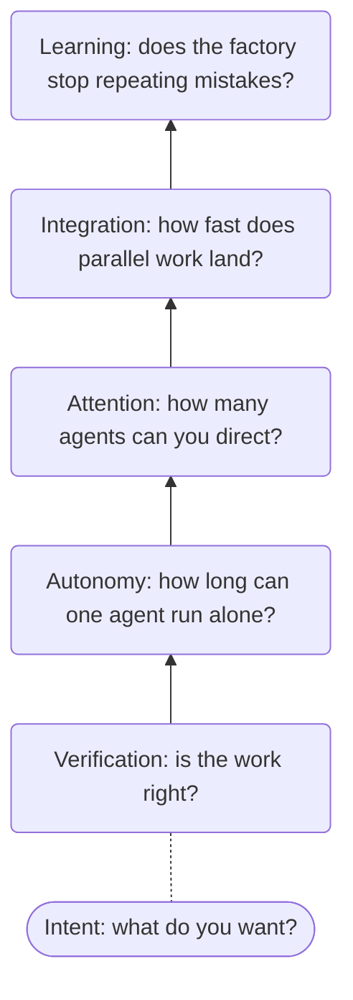

Hand a coding agent more work, and soon you're not writing code anymore. You're reading it, because nothing else tells you whether it's right. The agent isn't the slow part. You are.

That's a bottleneck, and it won't be your last. Knowing the order they come in tells you what to work on now.

## One bottleneck at a time

In _The Goal_, Eliyahu Goldratt describes a scout troop that can only hike as fast as Herbie, its slowest kid. Hurrying everyone else just stretches out the line. His Theory of Constraints says every system works this way: one constraint limits the whole, improving anything else is wasted effort, and relieving it moves the limit somewhere new.

A software factory is no different.

## The hierarchy

You'll usually meet these from the bottom up.

### Verification

Can the work be confirmed right without you reading it? [Poteto](https://x.com/poteto) makes the case that this is where to start. Until checking is cheap, every agent you add just adds to your reading. See [Validate](../03-the-dev-lifecycle/03-deliver/03-validate.md) and [spending time on levers](04-principles.md#spend-time-on-levers).

### Autonomy

How long can one agent run before it needs you? Once you trust its work, you'll notice how often it stops for a permission, a missing tool, or a decision it could have made itself. See [Loops](../04-loops/).

### Attention

How many agents can you direct at once? The limit is you again: which agent needs you, and what was it doing? See [Orchestration](../05-orchestration/).

### Integration

How fast does parallel work land? Five agents can open five pull requests in an hour, but each one still has to pass CI, merge cleanly, and deploy. See [Merge](../03-the-dev-lifecycle/03-deliver/04-merge.md) and [Deploy](../03-the-dev-lifecycle/03-deliver/05-deploy.md).

### Learning

How fast does the factory stop repeating its mistakes? If each session makes the last one's mistake, you pay for it every time. See [Self-improvement](../06-self-improvement/).

### Intent

Beneath it all is deciding what you want. That's [the human's job](04-principles.md#use-the-human-for-what-only-the-human-can-do), and it never goes away. The point of climbing the hierarchy is to make intent the only bottleneck left.

## Why the order matters

Without cheap verification, ten agents means ten times the reading. Without autonomy, it means ten agents interrupting you. Each level pays off only once the ones below it are in place.

Real work isn't this tidy, and you'll hit a merge conflict on day one. But only one bottleneck limits you right now, and that's where your time goes furthest. You can also slide back down: a new codebase without tests puts you back at verification.

## Finding your bottleneck

Look at how you spent your day with agents:

- Reading diffs? Verification.
- Unblocking agents? Autonomy.
- Losing track of which agent needed you? Attention.
- Fixing merge conflicts or waiting on CI? Integration.
- Correcting the same mistake twice? Learning.

Whatever took the most time is your bottleneck. Work on that one. [Measuring the factory](../06-self-improvement/01-measuring-the-factory.md) covers doing this with numbers.
