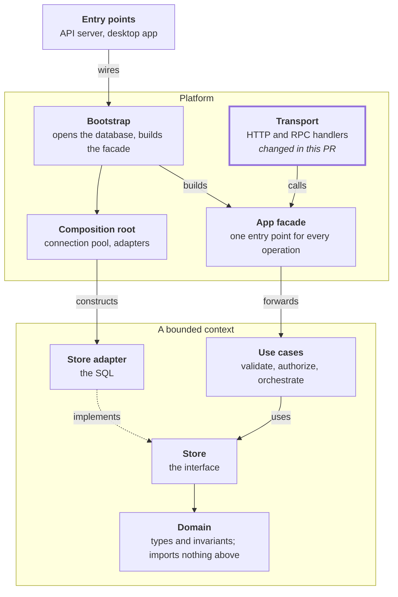

## What this section will cover

- Planning one slice before an agent builds it
- The more you settle in the plan, the less structural verification you need later: a plan that pins down the architecture, the boundaries, and the approach leaves less for review to catch
- A common failure mode: getting impatient and telling the agent to "just get started already," which moves the hard thinking into verification, where it costs more
- Capture a planning checklist as a [Code Rules](https://code-rules.fabricahq.com) rule, so every plan gets checked against it, whether you run the check or the agent checks its own plan
- Start a review checklist of what's "must review" and what's "nice to review"
  - Must review: layers, major data flows, schemas, and system vocabulary
  - Nice to review: function interfaces

## Layer diagrams

- Layer diagrams are super useful for planning and for PR reviews
- They show each layer, what it's for, and which layers it may depend on, so you can see at a glance whether a plan or a change respects the architecture
- For a PR, highlight the layers the change touches, such as the transport layer here

