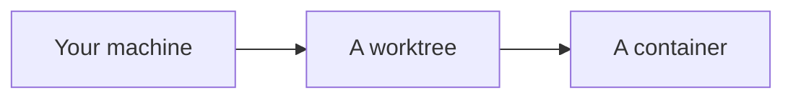

# The Fabrica book

This repository holds the text of the book published at
[fabricahq.com/book](https://fabricahq.com/book/). Write it in plain Markdown
with any text editor. The website turns these files into pages; nothing here
needs HTML or a build step.

The book is a work in progress, and contributions are welcome. Open an issue
for a correction or an idea, or send a pull request that follows the layout
below. Every page on the website ends with a "Suggest an edit to this page"
link, which opens the
[Suggest an edit](https://github.com/fabricahq/book/issues/new?template=suggest-an-edit.yml) issue form with
the page already filled in.

## License

Unless otherwise noted, the book's text and original diagrams are licensed
under [Creative Commons Attribution-NonCommercial-ShareAlike 4.0 International
(CC BY-NC-SA 4.0)](https://creativecommons.org/licenses/by-nc-sa/4.0/).
See [LICENSE](LICENSE) for the full terms.

Noncommercial sharing and adaptation are welcome with attribution and the
required notices. Shared adaptations must follow the license's ShareAlike
terms. Fabrica also grants [additional permission for commercial copying of
diagrams and excerpts](92-faq/index.md#can-companies-copy-diagrams-or-quote-paragraphs-and-pages),
including use in company documentation, presentations, and paid courses.
Selling the whole book or commercially distributing an adapted edition still
requires separate permission, unless a copyright exception applies. See the
[licensing FAQ](92-faq/index.md#what-license-does-the-book-use) for the terms
and how to request permission.

## How publishing works

1. You push to `main`.
2. A workflow in this repository asks the website's repository,
   fabricahq/website, to sync the book. That repository is private.
3. The website copies these files, checks them, and checks the whole site.
4. If every check passes, the change lands on the website's `main` and
   publishes a few minutes later. If a check fails, nothing publishes. The
   failed "Sync book" run in the website's Actions tab lists each problem with
   the file to fix; seeing it takes access to the website's repository.

Everything you push to `main` here will be on the website.

## Layout

```text
index.md                      the book's title, and its introduction as the body
01-introduction/              a chapter
  index.md                    the chapter's title and intro
  01-what-a-software-factory-is.md   a section
02-foundations/
  index.md
  01-a-codebase-agents-can-work-in.md
  02-the-environment.md
  images/worktrees.png        images, anywhere in the book
03-the-dev-lifecycle/
  index.md
  01-spark.md
  02-shape/                   a phase: a group of sections in a chapter
    index.md                  the phase's title and intro
    01-explore.md             a section of the phase
  03-deliver/
    index.md
    01-plan.md
90-toolbox/                   an appendix: index.md says appendix: true
  index.md
changes/                      the changelog: one entry per update
  environment-isolation.md    an entry
```

- The book is a list of **chapters**. Each chapter is a folder with an
  `index.md`.
- A chapter holds **sections**. Each section is one Markdown file in the
  chapter's folder.
- A chapter can group some of its sections into **phases**. A phase is a
  folder in the chapter holding its sections and an `index.md` with the
  phase's title and intro, like a chapter's. The phase gets its own page, and
  the contents lists it like a section, with its sections indented under it.
  Phases hold sections, not other phases.
- `index.md` at the top holds the book's title in its front matter and the
  book's introduction as its body. The introduction opens the book's page on
  the website, beside the cover, so keep it to a few sentences; it can have
  more than one paragraph.
- A chapter or appendix whose folder is named `faq` after its number, such as
  `92-faq/`, is the book's FAQ page. The note on the book's landing page links
  to it ("To learn more, see the Book FAQs"); without one, the note has no
  link.
- Other folders, such as `images/`, can hold images and other files. They
  cannot hold Markdown, because a folder of Markdown inside a chapter is a
  phase. The one exception is `changes/` at the top of the book: its Markdown
  files are the entries of [the changelog](#the-changelog), never pages.

## Order and numbers

Each chapter folder, phase folder, and section file name starts with a number
and a hyphen, such as `02-foundations`, `02-shape`, or `03-plan.md`. The numbers
set the order and nothing else. A chapter's sections and phases share one order,
so `01-spark.md` comes before `02-shape/`.

Readers see numbers that come from that order:

- Chapters are numbered 1, 2, 3, and so on.
- Sections are numbered within their chapter: 2.1, 2.2, 2.3. A phase is
  numbered like a section, and its sections are numbered within it: phase 3.3
  holds 3.3.1, 3.3.2, and so on.
- Appendices are lettered A, B, C after the last chapter, with sections A.1,
  A.2.

So you never type a number into a title. To move a section, rename its file:
`05-merge.md` to `03-merge.md`. Everything renumbers. Gaps are fine, so
`10-`, `20-`, `30-` leaves room to insert `15-` later. Two files with the same
number in one folder are an error, and so are a file and a phase folder with
the same number.

Page addresses use the name without its number, and leave out any phase, such
as `fabricahq.com/book/foundations/the-environment/` and
`fabricahq.com/book/the-dev-lifecycle/explore/`. So links keep working when you
reorder, or when you move a section into or out of a phase. A phase's own page
sits beside its sections, at `fabricahq.com/book/the-dev-lifecycle/shape/`.
Renaming the part after the number changes the address, and no two phases or
sections in one chapter can share a name, even in different phases. No chapter
can be named `changes`, because the changelog is at
`fabricahq.com/book/changes/`.

Names use lowercase letters, digits, and hyphens.

## Front matter

Each page can start with a few `key: value` lines between `---` lines:

```markdown
---
title: A codebase agents can work in
status: draft
---

The section's text starts here.
```

| Field      | Where                                 | Meaning                                                                                                                                    |
| ---------- | ------------------------------------- | ------------------------------------------------------------------------------------------------------------------------------------------ |
| `title`    | Every page, and every changelog entry | A page's title: required, unless the file starts with a `# Title` line, which then becomes the title. An entry's headline: required.       |
| `status`   | Chapters, phases, and sections        | `planned`, `draft`, or `solid`. Leave it out for `solid`.                                                                                  |
| `subtitle` | A chapter's `index.md`                | Optional. One line shown in italics under the chapter's title, in the contents and on the chapter's page.                                  |
| `appendix` | A chapter's `index.md`                | `true` makes the chapter an appendix. Appendices come after every chapter.                                                                 |
| `kind`     | A changelog entry                     | Required: `new`, `major-update`, `minor-update`, or `removed`. An entry sets only `kind` and `title`. See [the changelog](#the-changelog). |

Any other field is an error, so a typo such as `stauts` cannot hide.

Readers see each status with one definition: **Planned** has an outline, but is
not yet written out; **Draft** is written, but not yet complete or polished;
**Written** is finished, at least for now. So a planned section needs an
outline: list what it will cover below its front matter. A planned chapter or
phase needs none, since its sections are its outline.

### Status

- `planned`: an outline of what the page will cover. The page opens with a
  note that it is not written yet.
- `draft`: written but still changing. The page opens with a note that it may
  change.
- `solid`: finished, shown to readers as "Written". The page has no note.

While every page has the same status, the contents says so in one sentence
and marks no rows. Once statuses differ, each section shows its own circle,
with a key explaining them: a hollow circle for planned, a half-filled circle
for draft, and a filled circle for written. Hovering a circle names its status
too. Drafts are labeled "Draft", and planned titles, chapters included, are
lighter. Each page shows its own
status; a chapter's status says nothing about its sections.

### Updated dates

Each chapter, phase, and section page shows the day it was last updated: the
day of the last commit that changed its file, in that commit's time zone. You
never type a date. Renaming or moving a file changes it too, so reordering
updates the dates of the pages that moved. When an update in the changelog
links to the page, the date links to the page's own list of updates;
otherwise, to the file's commits on GitHub.

## Writing

Use ordinary Markdown, including tables and code blocks. The page title is the
page's top heading, so start your own headings at `##`. Raw HTML shows as
text, with one exception below.

### Collapsible sections

To tuck away something only some readers need, such as an example, put it in a
collapsible section, written the way GitHub shows one:

````markdown
<details>
<summary>Show me an example</summary>

```text
Explain how agents resolve merge conflicts

Update: merge-page
```

</details>
````

Readers see "Show me an example" and open it to see what it hides. Leave a
blank line after the `<summary>` line and before `</details>`, so what it hides
is ordinary Markdown. The label is plain text. A section that is never closed,
or that is written any other way, is an error.

### Links and images

Link to other pages with relative paths to their files, the way they work on
GitHub:

```markdown
See [Plan](../03-the-dev-lifecycle/03-deliver/01-plan.md) and its
[checklist](../03-the-dev-lifecycle/03-deliver/01-plan.md#checklist).
Link a whole chapter or phase by its folder: [Foundations](../02-foundations/).


```

- Links to headings use GitHub's anchors: lowercase, punctuation removed,
  spaces turned into hyphens. A repeated heading gets `-1`, `-2`, and so on.
  Link a heading on the same page with just its anchor, such as `#checklist`.
- A query, such as `?v=2`, stays on the link as written.
- Images and linked files can be `.png`, `.jpg`, `.jpeg`, `.gif`, `.webp`,
  `.avif`, `.svg`, or `.pdf`. Only files a page uses are published.
- A link to a file or heading that does not exist is an error. Links to other websites
  start with `https://`.

### Diagrams

Draw a diagram with a [Mermaid](https://mermaid.js.org/) code block. GitHub
shows it as a diagram, and the website draws it in the site's colors, in light
and dark:

````markdown

````

- `accTitle` names the diagram for screen readers, the way alt text names an
  image. It is required. `accDescr` adds an optional longer description.
- Flowcharts, state, sequence, class, and ER diagrams, and XY charts, are
  supported. A diagram that cannot be drawn is an error.

### Left out of the book

These are never published, so you can keep notes beside the book:

- Any file or folder whose name starts with `_`, such as `_notes.md` or
  `_drafts/`.
- Hidden files and folders, whose names start with `.`.
- Markdown files named in capitals, such as `README.md` (including this one),
  `CONTEXT.md`, and `AGENTS.md`. These are documents about the repository.

## The changelog

The changelog at `fabricahq.com/book/changes/` tells readers what has changed
in the book. It lists **updates**: changes readers would care about, each
described once however many commits it took.

Record an update as one Markdown file in `changes/`, called its **entry**:

```markdown
---
kind: major-update
title: Updated The environment to start from where agents run
---

- [The environment](../02-foundations/02-the-environment.md): now starts
  from where agents run, from your machine to a container.
- [Guardrails and budgets](../04-loops/03-guardrails-and-budgets.md): now
  treats an isolated workspace as the first guardrail.
```

- The file name without `.md` is the update's name, such as
  `environment-isolation`. It uses lowercase letters, digits, and hyphens.
  The name identifies the update, so keep it once you have committed the
  entry. Subfolders such as `changes/2026/` can group entries, and no two
  entries anywhere in `changes/` can share a name.
- The front matter has two required fields: `kind`, and `title`, a one-line
  headline for the update. Any other field is an error.
- The title says what you did to the book, starting with a past-tense verb
  and naming the page or topic: "Added a page on pruning", "Updated the
  hierarchy of bottlenecks with real examples", "Removed the page on product
  validation". Save the insight itself for the body.
- The body lists the pages the update touched, each linked and followed by
  what it now covers or what changed there, such as "covers retiring rules
  that no longer earn their place" or "now starts from isolated workspaces".
  An optional sentence before the list can give the reason. Link to pages the
  way pages link to each other: relative to the entry, as in the example.
  Those links are the update's pages.
- The changelog sets each item that starts with a page link like the contents:
  the page's number and title as the link, then your note on a line of its
  own, with pages grouped under a small header naming their chapter or
  appendix. A chapter's own page appears under its header as "Overview". The
  page's current number and title replace your link text, so they stay right
  as the book changes.

### Kinds

An update has one kind, its most significant. Change it as the update grows,
such as from `minor-update` to `major-update`.

| Kind           | On the changelog     | Use it when                                                               |
| -------------- | -------------------- | ------------------------------------------------------------------------- |
| `new`          | Listed, marked "New" | You add a page or chapter.                                                |
| `major-update` | Listed               | The guidance changes enough that a reader might think differently.        |
| `minor-update` | Not shown            | A page keeps its core message and says it better, or moves or is renamed. |
| `removed`      | Listed               | You take a page out.                                                      |

The changelog lists the 20 latest updates that are not minor, newest first,
each with its date, its title, and its summary. Only new pages carry a badge,
"New" under the date, so they stand out. Readers can filter the changelog to new
pages, updates, or removals; each filter is its own page, such as
`/book/changes/updates/`. Each update lists its commits, collapsed under their
count, each linking to the commit on GitHub. Every page has its own list of the
updates that link to it, at `/book/changes/page/` followed by the page's
address, such as `/book/changes/page/introduction/principles/`; when an
update links to the page, the page's updated date links there. The note on the book's home page links to the
changelog. Minor updates are recorded but never shown, so they never bury the
changes that matter. Until you commit the first entry, the website has no
changelog page.

### Commits and dates

You never type a date. An update's commits are the commits that edited its
entry, and those that name the update in an `Update:` line at the end of their
message, after a blank line:

```text
Explain how agents resolve merge conflicts

Update: merge-page
```

A commit can name several updates, on lines of their own or on one line
separated by commas, and a commit that both edits an entry and names it counts
once. An update's date is the day of the latest of its commits, in that
commit's time zone. So to keep working on an update over several days, name it
in each commit, and it moves back to the top. In the local preview, an entry you
have not committed yet shows at the top, marked "Not committed yet".

An `Update:` line naming an update that no entry has ever had, usually a typo,
is an error that lists the commits naming it. A pushed commit can't be changed,
so add an entry with that name, or give that name to the entry the commits
meant. A name whose entry you have since deleted is fine: its commits left the
changelog with the entry.

### Every commit names its update

Every commit belongs to an update, or says it doesn't. A commit that edits an
entry belongs to that update. Any other commit ends with an `Update:` line
naming its update, or, when it changes nothing readers would notice, such as a
fix to this README, with this line:

```text
Changelog: none
```

A git hook can check each commit as you make it. When a commit names no update,
the hook stops it, says what to add, and lists the updates you changed most
recently. It needs only Node. Install it with
[prek](https://github.com/j178/prek):

```sh
prek install
```

Amending a commit keeps the changes it already had, so amending one that
edited an entry needs no `Update:` line, unless you give it a new message
with `-m`: git doesn't tell the hook that's an amend, so name the update in
the new message.

Commits in a pull request don't need these lines: whoever merges it names the
update when squash-merging, and the check on the pull request only notes the
commits that don't. On `main`, the same check flags any commit that slipped
through without one. The check lives in `.github/commit-check/`, with its tests:

```sh
node .github/commit-check/commit-check.mjs origin/main..HEAD
node --test '.github/commit-check/*.test.mjs'
```

### Links to pages that are gone

Entries are history. A summary's link to a page that has since been renamed or
removed shows as plain text instead of an error, and a link to a heading that
is gone still leads to its page, so old entries never need fixing. Every other
link rule still applies.

## Preview while writing

Run the website locally and read the book from this checkout. Pages update as
you save. This takes access to the website's repository, which is private.
Without it, GitHub's preview of each Markdown file, diagrams included, is a
close match.

1. Check out fabricahq/website next to this repository, so the two folders
   are siblings, and install its tools as its README describes.
2. In the website checkout, run:

   ```sh
   bun run dev:book
   ```

3. Open the `/book/` address it prints.

If this checkout is somewhere else, set `BOOK_DIR=/path/to/book`. If it does
not exist yet, `dev:book` clones it for you.

Problems show in the terminal and in the browser, and the page reloads when
they are fixed. To check the book without the preview, run
`bun run book:check ../book` in the website checkout.
